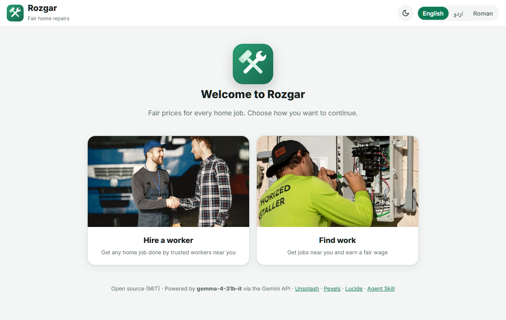
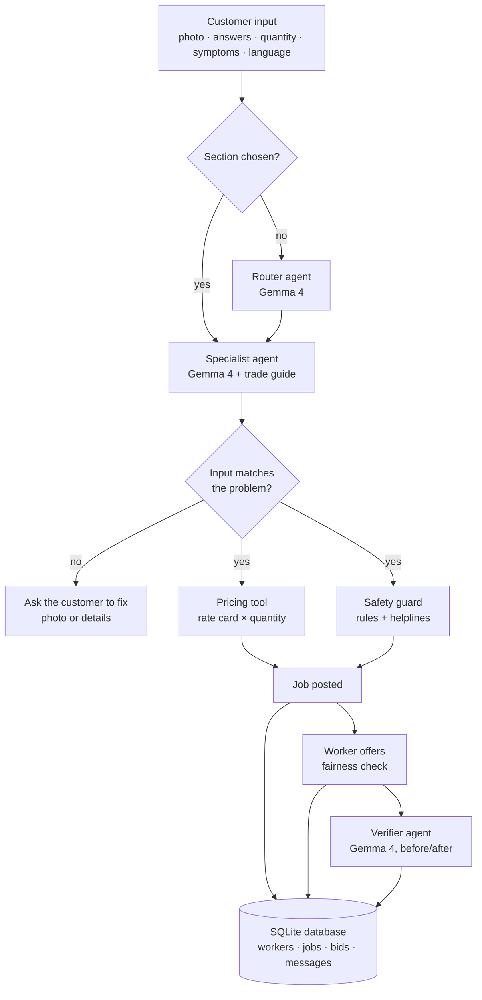

<div align="center">


# Rozgar

**Fair prices for home repairs in Pakistan, powered by Gemma 4**

[](LICENSE)
[](https://ai.google.dev/gemma)
[](https://www.python.org/)
[](https://fastapi.tiangolo.com/)
[](skills/rozgar-repair-estimator/SKILL.md)

English · اردو · Roman Urdu



</div>

---

## Contents

- [Overview](#overview)
- [Features](#features)
- [How Gemma 4 is used](#how-gemma-4-is-used)
- [Architecture](#architecture)
- [Pricing model](#pricing-model)
- [Getting started](#getting-started)
- [Deployment](#deployment)
- [Project structure](#project-structure)
- [API reference](#api-reference)
- [Agent Skill](#agent-skill)
- [Limitations](#limitations)
- [Roadmap](#roadmap)
- [Credits and licenses](#credits-and-licenses)

## Overview

Every week, millions of households in Pakistan hire an electrician, plumber, mason or technician, and both sides lose out:

- **Customers are overcharged** because they don't know what a job should cost.
- **Honest workers are underpaid** because haggling pushes prices below a fair wage.
- **Many people can't describe the problem**, especially when it's inside a closed machine like a washing machine or water pump.
- **Nobody can prove the work was done** before money changes hands.

Rozgar is a two-sided marketplace that puts **Gemma 4 between customer and worker as a neutral helper**. It understands the problem, sends it to the right trade, estimates a fair price with a transparent formula, checks every offer, and verifies the finished work from photos.

Built at **Hacktoberfest Hack Day Faisalabad 2026** for the *Best Open-Source AI Project* and *Best Use of Gemma 4* challenges.

## Features

**For customers**
- Input checking: Gemma rejects a photo or description that doesn't match the chosen problem (for example a plumbing photo under "Burnt socket") and suggests the right section. Unrealistic quantities are refused.
- 7 trade sections and 40 problem types, each with short guided questions (size, depth, symptoms).
- A quantity field in the unit workers charge by: feet, square feet, items or jobs.
- A symptoms checklist for machines that can't be photographed, with an optional photo of the model sticker.
- An explained cost estimate, with materials added only if the worker brings them.
- Safety warnings with helplines for gas, electrical and structural danger.
- Booking details: address, landmark, preferred day, time slot and payment method.
- A live check on the price you enter: reasonable, too low, or above the estimate.
- InDrive-style offers: while the job is open, offers from nearby workers arrive as cards with rating, distance in km and price, cheapest first, each with Accept and Decline. In the demo, a few labelled sample workers respond within seconds (`ROZGAR_SAMPLE_OFFERS=0` turns this off).
- Nearby workers with ratings, experience and past projects; invite specific workers or post to all.
- A **Messages** inbox: one conversation per job and worker, with unread badges, timestamps and a chat button on every offer. It works before and after accepting.
- Delete a posted job at any time. Only the browser that posted it holds the job's private delete key.

**For workers**
- Sign in, or join with trade, area, experience and CNIC.
- Job cards in the worker's language, with what to do and what to bring.
- Offers checked against the estimate.
- Before/after photo verification; verified jobs are added to the worker's portfolio.

**For everyone**
- Simple tabs: New job · My jobs · Messages for customers, and Jobs · Messages for workers. The address bar remembers the tab (`#jobs`, `#messages`).
- Non-blocking notifications, buttons that can't be pressed twice, and automatic refresh that pauses while the browser tab is hidden.
- Full interface in English, Urdu (right-to-left) and Roman Urdu; Gemma answers in the same language.
- Light and dark mode.
- An **Agent trace** panel showing every AI step, the model used and its output.

## How Gemma 4 is used

| | |
|---|---|
| **Primary model** | Gemma 4 31B (`gemma-4-31b-it`) |
| **Fallback model** | Gemma 4 26B (`gemma-4-26b-a4b-it`) |
| **Access** | Gemini API via the [`google-genai`](https://github.com/googleapis/python-genai) SDK |
| **Weights** | Open-weight, [Apache 2.0](https://ai.google.dev/gemma/apache_2) |

Gemma 4 runs three agents:

| Agent | Input | Output |
|---|---|---|
| **Router** | Photo and description | The trade section and a confidence score; asks a clarifying question when unsure |
| **Specialist** | Photo or symptoms, guided answers, quantity, and the trade's guide | First checks that the photo and details match the chosen problem; then diagnosis, likely cause, materials, safety level and a job card in the chosen language |
| **Verifier** | Before and after photos | Whether the job is fixed, the visible evidence and a confidence score |

Only Gemma 4 models are used. Gemma never sets the price; see [Pricing model](#pricing-model).

## Architecture



- **AI for understanding, rules for money and safety.** Gemma 4 handles images, language and diagnosis. Prices and safety rules are plain Python, so every number can be checked.
- **Input checking.** No estimate is made on mismatched photos or details, and quantities have sensible limits (for example at most 300 ft for a crack).
- **Persistent storage.** Workers, jobs, offers and chat messages are stored in SQLite (`data/rozgar.db`), created automatically on first run and seeded with the sample workers.
- **Validated output.** Each agent must return JSON matching a Pydantic schema; invalid replies are repaired once.
- **Resilience.** The app retries busy or failed calls, alternating between the two Gemma 4 models with a short cooldown. It also rotates API keys on rate limits and shows clear errors instead of crashing.

Code: [`app/orchestrator.py`](app/orchestrator.py) · [`app/agents.py`](app/agents.py) · [`app/pricing.py`](app/pricing.py)

## Pricing model

Rozgar prices jobs the way workers in Pakistan quote: per foot, per square foot, per item or per job.

```
labour   = max(quantity × rate per unit × difficulty, minimum charge)
total    = labour + materials (only if the worker brings them)
estimate = total ± 15%
```

- **Rates and minimums** come from [`catalog.json`](skills/rozgar-repair-estimator/catalog.json) and [`rates.json`](skills/rozgar-repair-estimator/rates.json) (Faisalabad 2026 estimates, editable).
- **Difficulty** is a small factor (1.0–1.5) from the guided answers, such as crack depth.
- **The customer must answer** the quantity and all guided questions before an estimate is made, so nothing is guessed.
- **Fairness check:** an offer more than 25% above the estimate is flagged as high; one more than 25% below is flagged as unfair to the worker.

Example: a 6 ft surface crack where the customer buys the materials comes to about **Rs 680–920**.

## Getting started

**Requirements:** Python 3.10+ and a free [Gemini API key](https://aistudio.google.com/apikey).

```bash
git clone https://github.com/mkhalil9871-cmyk/rozgar.git
cd rozgar
pip install -r requirements.txt
cp .env.example .env          # add your GEMINI_API_KEY
python -m uvicorn app.main:app --port 8000
```

Open <http://localhost:8000>. On Windows you can double-click `run.bat`.

To see both sides, open two tabs: choose **Hire a worker** in one and **Find work** in the other. Demo login details are in [Limitations](#limitations).

**Environment variables**

| Variable | Required | Description |
|---|---|---|
| `GEMINI_API_KEY` | Yes | Gemini API key |
| `GEMINI_API_KEYS` | No | Extra keys, comma-separated, used when one hits a rate limit |
| `GEMMA_MODEL` | No | Primary model (default `gemma-4-31b-it`) |
| `GEMMA_FALLBACK_MODEL` | No | Fallback model (default `gemma-4-26b-a4b-it`) |
| `ROZGAR_DB` | No | Path of the SQLite database (default `data/rozgar.db`) |
| `ROZGAR_SAMPLE_OFFERS` | No | `1` (default) lets sample workers send offers in the demo; `0` turns it off |

## Deployment

**Hugging Face Spaces (free, no card required)**
1. Create a new Space with the **Docker** SDK and the **Blank** template.
2. Under **Settings → Variables and secrets**, add the secret `GEMINI_API_KEY`.
3. Push this repository to the Space. The included [`Dockerfile`](Dockerfile) serves the app on port 7860.

**Other hosts.** The Dockerfile runs on any container host. A [`render.yaml`](render.yaml) is included for Render.

The app stores data in a SQLite file and needs a single, always-on process. On hosts with temporary disks (including free Hugging Face Spaces), the database resets when the container restarts unless persistent storage is attached. Serverless platforms such as Vercel would need an external database.

## Project structure

```
app/
  main.py            FastAPI routes
  orchestrator.py    Multi-agent pipeline (Router, Specialist, Verifier)
  agents.py          Gemma 4 calls, schemas, retries and failover
  pricing.py         Rate card, safety rules, fairness check, worker matching
  store.py           SQLite database: workers, jobs, offers (bids) and chat messages
static/              Frontend (HTML, CSS, JavaScript, translations, images)
skills/rozgar-repair-estimator/
  SKILL.md           Agent Skill definition
  catalog.json       Problem types, guided questions, units and rates
  rates.json         Trades, hourly rates and material prices
  workers.json       Sample worker profiles
  sections/          One guide per trade
Dockerfile           Container for Hugging Face Spaces and other hosts
```

## API reference

| Method | Endpoint | Description |
|---|---|---|
| `GET` | `/api/health` | Active model and number of keys loaded |
| `GET` | `/api/sections` · `/api/catalog` · `/api/trades` | Sections, problem types and trades |
| `GET` | `/api/workers?section=&trade=&area=` | Workers, best match first |
| `POST` | `/api/workers` | Register a new worker |
| `POST` | `/api/diagnose` | Run the pipeline: photo, answers, quantity, symptoms and language in; diagnosis, estimate, safety and trace out |
| `POST` | `/api/jobs` | Post a job with price and booking details |
| `GET` | `/api/jobs?section=` | List jobs |
| `POST` | `/api/jobs/{id}/bids` | Send a worker offer |
| `POST` | `/api/jobs/{id}/accept` | Accept an offer |
| `POST` | `/api/jobs/{id}/messages` | Send a chat message |
| `DELETE` | `/api/jobs/{id}` | Delete a job (requires the `X-Owner-Token` returned when it was posted) |
| `POST` | `/api/jobs/{id}/verify` | Verify the work from an after photo |

## Agent Skill

[`skills/rozgar-repair-estimator`](skills/rozgar-repair-estimator/SKILL.md) follows the [Agent Skills open standard](https://agentskills.io). It packages the full method (route, ask, diagnose, price, check safety, check offers, verify) together with its open data files.

The app reads these same files at startup, so the product and the skill always match. Any agent that supports the standard can use the skill on its own; to adapt it to another city, edit the rates.

## Limitations

This is a hackathon prototype.

- **Worker profiles are samples** and are labelled as such. Each worker also sees one labelled sample job.
- **Login is a demo.** No SMS is sent (code `1234`, worker PIN `1234`). Phone and CNIC numbers are checked for format only and are never stored.
- **Data is stored in a local SQLite file.** It survives restarts on your machine, but a free cloud host may reset it when the container is rebuilt.
- **Rates are estimates** for Faisalabad and should be adjusted locally.
- **Photo verification is a helpful check**, not proof; the customer makes the final decision.

## Roadmap

- Payment held through JazzCash or Easypaisa and released when Gemma verifies the work
- Verified worker onboarding (CNIC) and customer ratings
- WhatsApp intake: send a photo, receive an estimate
- Urdu voice input and output for people who can't read
- City-specific rates learned from accepted offers

## Credits and licenses

| Component | License |
|---|---|
| Rozgar code and logo | [MIT](LICENSE) |
| Gemma 4 | [Apache 2.0](https://ai.google.dev/gemma/apache_2) |
| FastAPI, Pydantic | MIT |
| Uvicorn, python-dotenv | BSD-3-Clause |
| google-genai, python-multipart | Apache 2.0 |
| [Lucide](https://lucide.dev) icons | ISC |
| Photos | [Unsplash License](https://unsplash.com/license), [Pexels License](https://www.pexels.com/license/) |
| Fonts: Inter, Noto Nastaliq Urdu | SIL Open Font License |

> Estimates are guidance, not quotes. For gas leaks, sparking wiring or structural damage, contact the helpline and a qualified professional first.
